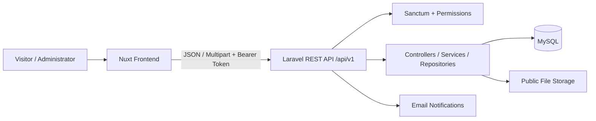

# metCasa — Real Estate Platform

**A full-stack real estate application built with Nuxt and Laravel.**

metCasa helps people explore properties for sale or rent in Iași and nearby areas. Visitors can search and filter listings, browse property photos and details, and contact owners. Registered users can save favorite properties and manage their profiles, while administrators maintain the property catalog.

This repository contains the **Laravel REST API**. It powers authentication, access control, property listings, favorites, notifications, and image storage for the separately maintained **Nuxt frontend**.

**[Frontend repository](https://github.com/biancabojescu/metcasa)** · **[Backend repository](https://github.com/biancabojescu/metcasa-api)**

## Features

- **Property listings:** provide filtered and paginated property data for sale and rental listings, with property details and active/inactive statuses.
- **Account management:** registration, login, logout, email verification, password recovery, and profile updates.
- **Authentication and permissions:** Laravel Sanctum bearer tokens and role-based authorization using Spatie Laravel Permission.
- **Favorites:** save, list, and remove properties associated with an authenticated account.
- **Listing administration:** protected operations to create, update, archive, and delete properties.
- **Image management:** accept image uploads, preserve selected existing images on edits, and remove files no longer attached to a listing.
- **Email notifications:** support account verification and password reset messages.

## Tech Stack

| Backend (this repository) | Frontend (separate repository) |
| --- | --- |
| PHP 8.3+, Laravel 13 | Nuxt 4, Vue 3, TypeScript |
| Laravel Sanctum, Spatie Permission | Pinia, Nuxt UI, Tailwind CSS |
| Eloquent ORM, MySQL | pnpm, API composables |
| Laravel filesystem, Mail, PHPUnit | Client-side routing and state management |

## Technical Highlights

### REST API with separated responsibilities

The Laravel backend organizes endpoints, business operations, and data access around controllers, services, repositories, and Eloquent models. The Nuxt frontend communicates with the API under `/api/v1`, keeping user-interface concerns separate from persistence and authorization.

### Authentication and role-based access

The API provides token-based authentication with Laravel Sanctum. Protected operations are authorized on the backend using roles and permissions, independently of any navigation guards in the frontend. The account flows also support email verification and password recovery.

### Server-side property filtering and pagination

Property search is processed by the API instead of downloading the full catalog into the browser. The frontend sends filter, sorting, and pagination parameters, and the backend returns the corresponding page and metadata for navigation.

### Favorites and listing availability

Favorites are linked to authenticated users. The API exposes favorite identifiers separately from paginated active listing details, allowing the frontend to display saved states without loading every favorited property at once.

### Property image lifecycle

Listing forms submit multipart requests. During edits, the API distinguishes retained images (`keep_images[]`) from newly uploaded files (`new_images[]`), updates the stored image list, and removes discarded media from storage.

## Architecture

The application consists of a client-rendered Nuxt frontend and a standalone Laravel API responsible for data, access control, and media.



Main backend directories:

- `routes/` — API route definitions.
- `app/` — controllers, models, authorization, and application logic.
- `database/migrations/` — relational database schema.
- `database/seeders/` — initial data, including roles and permissions.
- `config/` — application, authentication, database, filesystem, mail, and CORS configuration.
- `tests/` — Laravel/PHPUnit tests.

## Getting Started

You'll need **PHP 8.3+**, **Composer**, **MySQL**, and Git. For the full application, run the [Nuxt frontend](https://github.com/biancabojescu/metcasa) separately.

### 1. Set up the backend

```bash
git clone https://github.com/biancabojescu/metcasa-api.git
cd metcasa-api
composer install
```

Copy `.env.example` to `.env` and create a local MySQL database. Configure values for your environment:

```dotenv
APP_URL=http://localhost:8000
FRONTEND_URL=http://localhost:3001
FRONTEND_ORIGINS=http://localhost:3001,http://127.0.0.1:3001

DB_CONNECTION=mysql
DB_HOST=127.0.0.1
DB_PORT=3306
DB_DATABASE=metcasa_api
DB_USERNAME=your_database_user
DB_PASSWORD=your_database_password

MAIL_MAILER=log
```

Generate the application key, create the database tables, seed roles, and expose public media:

```bash
php artisan key:generate
php artisan migrate
php artisan db:seed --class=RolesAndPermissionsSeeder
php artisan storage:link
php artisan serve --host=localhost --port=8000
```

The API is available at **http://localhost:8000**, with application endpoints under `/api/v1`.

<details>
<summary><strong>Connect the Nuxt frontend</strong></summary>

Clone the separate frontend repository:

```bash
git clone https://github.com/biancabojescu/metcasa.git
cd metcasa
pnpm install
```

Copy its `.env.example` to `.env` and configure:

```dotenv
API_URL=http://localhost:8000/api/v1
BASE_URL=http://localhost:3001
```

Then run:

```bash
pnpm dev
```

Open **http://localhost:3001**. The backend's `FRONTEND_ORIGINS` must include this origin, and `FRONTEND_URL` must point to it for account email links.

</details>

<details>
<summary><strong>Enable the administration dashboard locally</strong></summary>

New accounts are not assigned the `super admin` role automatically. After registering a test account, run:

```bash
php artisan tinker
```

```php
$user = App\Models\User::where('email', 'developer@example.com')->firstOrFail();
$user->assignRole('super admin');
```

Replace the example email with your local test account. Log out and back in to refresh the frontend's role data.

With `MAIL_MAILER=log`, local email verification and password reset messages are written to `storage/logs/laravel.log` rather than sent externally.

</details>

## API Overview

The Nuxt frontend consumes API endpoints for:

| Area | Example operations |
| --- | --- |
| Listings | `GET /listings`, `GET /listings/{id}`, `POST /listings`, `POST /listings/{id}`, `DELETE /listings/{id}` |
| Authentication | `POST /auth/register`, `POST /auth/login`, `GET /auth/me`, `POST /auth/logout` |
| Profile | `POST /auth/profile` |
| Email and passwords | `POST /auth/email/resend`, `POST /auth/password/forgot`, `POST /auth/password/reset` |
| Favorites | `GET /favorites`, `POST /favorites/{id}`, `DELETE /favorites/{id}`, `DELETE /favorites` |

Paths in this table are relative to `/api/v1`. Protected requests use a bearer token.

## Current Limitations

metCasa is a portfolio project, not a production-hardened real estate service. Before production use, priorities include stronger automated test coverage, explicit email-verification enforcement where required, and reviewing how inactive listing records are exposed through public endpoints. Token lifetime and session policies also need review alongside the frontend's storage approach.
